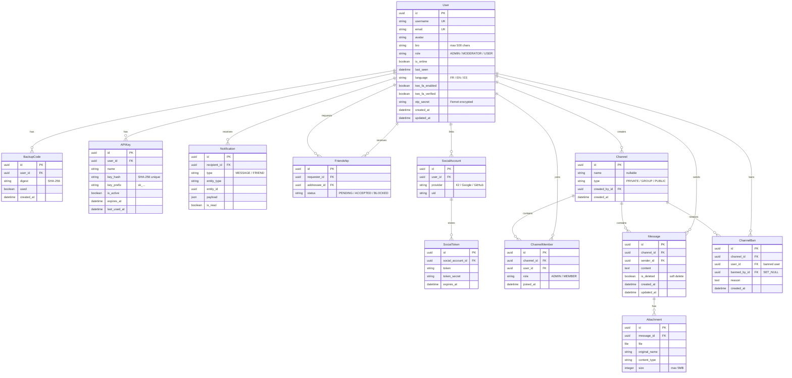

*This project has been created as part of the 42 curriculum by rbaticle, msingh, romukena, oamairi, ydembele*

# Transcendence

A security-first, real-time social platform: profiles, friendships, live chat with file
sharing, live notifications, a public REST API with API keys, and a hardened perimeter
(NGINX + ModSecurity WAF, HashiCorp Vault for secrets, JWT + TOTP two-factor
authentication).

**Table of contents**

- [Description](#description)
- [Instructions](#instructions)
- [Technical Stack](#technical-stack)
- [Database Schema](#database-schema)
- [Features List](#features-list)
- [Modules](#modules)
- [Team Information](#team-information)
- [Project Management](#project-management)
- [Individual Contributions](#individual-contributions)
- [Resources](#resources)
- [Known Limitations](#known-limitations)

---

## Description

**Transcendence** is a full-stack web application built as a modern social platform.
Users sign up with an email or through OAuth 2.0 (42, Google, GitHub), build a profile
with an avatar, connect with friends, and chat in real time in private, group or public
channels — with images and files, moderation tools, and instant notifications.

The project deliberately treats security and operations as features, not afterthoughts:

- **Authentication** — JWT with rate-limited login, optional TOTP two-factor
  authentication (QR code + 10 single-use backup codes), OAuth 2.0 sign-in.
- **Real time** — Django Channels (WebSockets) for chat and notification fan-out,
  with a reconnecting client and graceful connect/disconnect handling.
- **Public API** — a documented REST API (Swagger/ReDoc) with personal API keys,
  rate limiting and full CRUD on 5+ resources.
- **Permissions** — role-based access control (Admin / Moderator / User) enforced on
  both the backend (DRF permissions) and the frontend (route guards).
- **Hardened perimeter** — NGINX reverse proxy with ModSecurity + OWASP CRS (WAF),
  TLS everywhere, strict CSP, JSON audit logs, and every secret managed in HashiCorp
  Vault (AppRole auth, internal TLS, sealed on restart).
- **i18n** — the whole interface is translated in French, English and Spanish.

Everything runs in Docker Compose with one command (`make up`), including the Vault
initialization and the TLS material generation.

---

## Instructions

### Prerequisites

| Tool | Version | Notes |
| ---- | ------- | ----- |
| Docker Engine + Compose v2 | recent | the only hard requirement |
| GNU `make` | any | drives all commands |
| Git | any | to clone the repository |
| A modern browser | — | Chrome / Firefox / Edge |

No local Node.js or Python installation is required: everything runs in containers.
Ports **8080** and **4443** must be free on the host (the site is served on
`https://localhost:4443` with a self-signed certificate — accept the browser warning).

### First run

```sh
git clone <repository-url> && cd 42-Transcendence
cp .env.example .env      # then edit .env (see below)
make up
```

`make up` does everything:

1. Generates the Vault TLS material (local mini-CA) and fixes container permissions —
   a fresh clone with only a `.env` starts as-is.
2. Builds and starts all services (Vault, PostgreSQL, Redis, Mailpit, backend,
   frontend, NGINX/WAF).
3. Initializes Vault: unseal, AppRole creation, seeding of the secrets (the AppRole
   credentials `VAULT_ROLE_ID` / `VAULT_SECRET_ID` are written to `.env` automatically).
4. Starts the backend (Daphne/ASGI), which fetches its secrets from Vault at boot —
   no secret is ever read from `.env` at runtime.

`.env` values to fill in:

| Variable | Purpose |
| -------- | ------- |
| `POSTGRES_DB` / `POSTGRES_USER` / `POSTGRES_PASSWORD` | database credentials |
| `OAUTH_42_CLIENT_ID` / `OAUTH_42_CLIENT_SECRET` | 42 OAuth app (intra.42.fr) |
| `OAUTH_GOOGLE_CLIENT_ID` / `OAUTH_GOOGLE_CLIENT_SECRET` | Google OAuth providers |
| `OAUTH_GITHUB_CLIENT_ID` / `OAUTH_GITHUB_CLIENT_SECRET` | GitHub OAuth app |
| `TOTP_ENCRYPTION_KEY` | ≥ 32 chars, used to encrypt users' TOTP secrets at rest |
| `MODSEC_RULE_ENGINE`, `BLOCKING_PARANOIA`, `ANOMALY_INBOUND` | WAF tuning (sensible defaults provided) |
| `DEBUG` | Set stack to debug or production mode (default to debug) |

Then open **https://localhost:4443**.

> `.env` is listed in `.gitignore` and must never be committed.
> Privacy Policy and Terms of Service pages are accessible from the application footer
> (`/privacy` and `/terms`) with relevant content in FR/EN/ES.
> For production deployment, set `DEBUG=False` in your environment variables

### Demo data (optional)

```sh
docker compose exec backend sh -c 'eval "$(python3 /app/vault_fetch.py)" && python manage.py seed_data'
```

This creates demo users (password `Transcendence42!`, overridable via `SEED_PASSWORD`),
friendships, channels and messages so the UI is immediately explorable.

### Daily commands

| Command | Effect |
| ------- | ------ |
| `make up` | build + start everything, init Vault |
| `make down` | stop the stack |
| `make logs` | follow all logs |
| `make debug` | up + follow logs, then attach to the main services |
| `make test` | `make up` + WAF test / Backend test / Frontend test |
| `make waf-test` | sends SQLi / XSS / path-traversal probes and asserts they are blocked (403) |
| `make back-test` | backend test |
| `make front-test` | frontend unit tests (Vitest) |
| `make clean` / `make fclean` | stop, remove volumes / also remove images |
| `make re` | full reset then `make up` |


API documentation: **https://localhost:4443/api/docs/** (Swagger UI) and `/api/redoc/`.
Mailpit (dev SMTP catch-all) runs inside the compose network.

### Vault operations

- Vault runs in **server mode** with persistent file storage (`./vault/data`) and
  internal TLS (mini-CA). After any Vault container restart, re-unseal with the
  idempotent `sh vault/init.sh`.
- To rotate a secret: update it in `.env`, re-seed with
  `docker compose run --rm --entrypoint python3 -e VAULT_TOKEN=<token> backend /app/vault_seed.py`,
  then `docker compose restart backend` (note: rotating `DJANGO_SECRET_KEY`
  invalidates current sessions).
- Backup: stop Vault, archive `./vault/data` **and** `vault/keys/init.json`.
  Restore: put them back, `docker compose up -d vault`, then `sh vault/init.sh`.
- Never committed (gitignored): `vault/tls/*`, `vault/keys/*`, `vault/data/`,
  `vault/logs/`, `backend/media/`, `backend/logs/`.
- If `docker compose up` was run before `make up`, Docker may have created
  root-owned directories that poison the TLS setup — `make up` auto-repairs this
  (regenerates certificates, fixes permissions without sudo).

---

## Technical Stack

| Layer | Technology | Version |
| ----- | ---------- | ------- |
| Frontend | Angular (standalone components, signals, lazy routes), TypeScript | 21 |
| Styling | Tailwind CSS | 4 |
| i18n | ngx-translate (FR / EN / ES) | 18 |
| Frontend tests | Vitest + jsdom | 4 |
| Backend | Django + Django REST Framework | 6.0.5 / 3.17 |
| Real time | Django Channels + channels_redis + Daphne (ASGI) | 4.2 |
| Auth | SimpleJWT, django-allauth (custom 42 provider), pyotp, `cryptography` (Fernet) | — |
| API docs | drf-spectacular (OpenAPI 3) | — |
| Database | PostgreSQL | 15 |
| Cache / WS layer | Redis | 7 |
| Reverse proxy / WAF | NGINX + ModSecurity v3 + OWASP CRS (Paranoia 1, tuned per location) | — |
| Secrets | HashiCorp Vault (server mode, AppRole, KV v2, internal TLS) | 2.0 |
| Mail (dev) | Mailpit | latest |
| Orchestration | Docker Compose (hot-reload dev mounts) | v2 |

**Why these choices**

- **Angular** — a complete, opinionated framework (router, DI, forms, testing) that
  scales to a large SPA and enforces TypeScript everywhere; standalone components and
  signals keep the codebase modern. Chosen over lighter alternatives because the app
  has many interdependent views (chat, admin, notifications) that benefit from a
  structured framework.
- **Django + DRF** — "batteries included": ORM, migrations, admin, and a mature
  authentication ecosystem (allauth for OAuth, SimpleJWT for tokens). The project is
  strongly relational, which makes a full-stack framework with an ORM the natural fit.
- **PostgreSQL** — first-class Django support, ACID guarantees, UUID primary keys,
  JSON fields where needed, and it models our domain perfectly (users ↔ friendships ↔
  channels ↔ messages with integrity constraints). Chosen over NoSQL because the
  schema is highly relational with no denormalization pressure.
- **Channels + Redis** — the standard way to bring WebSockets to Django; Redis backs
  the channel layer for multi-instance-ready message fan-out and the Django cache.
- **ModSecurity + OWASP CRS** — battle-tested, free WAF integrated in NGINX; the CRS
  gives protection against SQLi/XSS/traversal out of the box, which `make waf-test`
  verifies continuously.
- **HashiCorp Vault** — secrets (DB URL, Django key, OAuth credentials, TOTP key)
  are fetched at boot via AppRole and never live in `.env` at runtime; Vault is sealed
  on restart and its keys stay outside the repository.

---

## Database Schema



Django ORM + migrations (`backend/users/models.py`, `backend/chat/models.py`,
`backend/api/models.py`). All primary keys are UUIDs.

```
User (root of every relationship, UUID PK)
 │
 ├─1:*─ BackupCode            (2FA single-use codes, stored hashed)
 ├─1:*─ APIKey                (personal API keys, SHA-256 hashed)
 ├─1:*─ Notification          (recipient)
 ├─1:*─ Friendship             (also → User as requester AND addressee,
 │                             unique (requester, addressee))
 └─1:*─ SocialAccount         (allauth: 42 / Google / GitHub)
            └─1:*─ SocialToken

Channel ──1:*── User (as created_by)
Channel ──1:*── ChannelMember ──*:1── User   (unique (channel, user),
 │                                            role ADMIN/MEMBER)
 ├──1:*── Message ──*:1── User (sender)      (soft delete, indexed
 │        └─1:*── Attachment                   (channel, created_at))
 └──1:*── ChannelBan ──*:1── User (banned user)
                    └──*:1── User (banned_by, SET_NULL)
```

Legend: `A 1:*─ B` = one A relates to many B (foreign key on B).

| Model | Key fields | Types | Relationships |
| ----- | ---------- | ----- | ------------- |
| `User` | `username` (unique), `email` (unique), `avatar`, `bio` (≤500), `role` (ADMIN/MODERATOR/USER), `is_online`, `last_seen`, `language` (FR/EN/ES), `two_fa_enabled`, `two_fa_verified`, `otp_secret` (Fernet-encrypted), `created_at`, `updated_at` | Text, Email, Image, Bool, DateTime | root of all other models |
| `BackupCode` | `digest` (SHA-256), `used`, `created_at` | Char(64), Bool, DateTime | FK → `User` (cascade) |
| `Friendship` | `status` (PENDING/ACCEPTED/BLOCKED), unique `(requester, addressee)` | Char, constraint | 2 FKs → `User` |
| `Channel` | `name` (nullable), `type` (PRIVATE/GROUP/PUBLIC), `created_at` | Char, DateTime | FK `created_by` → `User` |
| `ChannelMember` | `role` (ADMIN/MEMBER), `joined_at`, unique `(channel, user)` | Char, DateTime | FKs → `Channel`, `User` |
| `Message` | `content`, `is_deleted` (soft delete), `created_at`, `updated_at` | Text, Bool, DateTime | FKs → `Channel`, `User` (sender); indexed `(channel, created_at)` |
| `Attachment` | `file`, `original_name`, `content_type`, `size` (≤ 5 MB enforced) | File, Char, Int | FK → `Message` |
| `ChannelBan` | `reason`, `created_at`, unique `(channel, user)` | Text, DateTime | FKs → `Channel`, banned `User`, `banned_by` → `User` (null on delete) |
| `Notification` | `type` (MESSAGE/FRIEND), `entity_type`, `entity_id`, `payload` (JSON), `is_read` | Char, UUID, JSON, Bool | FK → `User` (recipient) |
| `APIKey` | `name`, `key_hash` (SHA-256, unique — raw key never stored), `key_prefix` (display, `sk_…`), `is_active`, `expires_at`, `last_used_at` | Char, Bool, DateTime | FK → `User` |

Django/allauth also manage the standard tables (sessions, admin logs, social
accounts/tokens).

---

## Features List

*Attribution is based on the areas of the repository each member authored (see
[Individual Contributions](#individual-contributions)).*

| Feature | What it does | Who |
| ------- | ------------ | --- |
| Registration / JWT login / refresh / logout | Email + password accounts, rate-limited login, short-lived access + refresh tokens, logout marks the user offline and is audit-logged | rbaticle, oamairi |
| Change password | Authenticated password change with current-password verification | rbaticle |
| OAuth 2.0 sign-in (42, Google, GitHub) | One-click sign-in via a custom allauth provider for 42 plus standard providers; account linking | rbaticle (backend), romukena (frontend) |
| Two-factor authentication (TOTP) | Per-user 2FA setup with QR code, encrypted secret at rest, 10 single-use backup codes, 2FA-gated chat access | rbaticle (backend), romukena (frontend) |
| Profiles | Public profile page (avatar, bio, stats), edit own profile, online status / last seen | oamairi (backend), romukena (frontend) |
| Avatar upload | Upload / replace / delete avatar with client + server validation; a default avatar is never deletable | rbaticle, oamairi |
| Friends | Send / accept / decline / remove friendships, block users, friends list with online status, private conversation created automatically when a request is accepted | oamairi, msingh (backend), romukena (frontend) |
| Channels (private / group / public) | Create channels, invite members, membership roles (admin/member) | oamairi, msingh |
| Real-time chat | WebSocket messaging with live fan-out (Redis channel layer), soft delete of messages, graceful connect/disconnect, reconnecting client | oamairi (backend), ydembele (frontend) |
| Moderation | Ban a user from a channel (with reason), kick members, admin/member rights per channel | oamairi |
| File sharing (attachments) | Upload images/documents to messages (≤ 5 MB, type/size validated both sides), previews, deletion, downloads served only through short-lived signed URLs | oamairi, rbaticle, msingh (backend), ydembele (frontend) |
| Notifications | Live (WebSocket) + REST notification inbox for messages and friend events, mark as read | oamairi (backend), ydembele (frontend) |
| Public REST API + API keys | Full CRUD (`GET/POST/PUT/PATCH/DELETE`) on users, channels, friendships, notifications and API keys; personal `sk_…` keys stored as SHA-256 hashes, with expiry and usage tracking | rbaticle, oamairi |
| RBAC admin panel | Admin/Moderator/User roles, user management CRUD, role-gated views on both sides (DRF permissions `IsSelfOrAdmin`, `Is2FADone`; Angular `roleGuard`) | rbaticle, oamairi (backend), ydembele (frontend) |
| i18n (FR / EN / ES) | Full translation of every user-facing string, language switcher, per-user language preference, `i18n:check` script guards missing keys | msingh, ydembele |
| Security perimeter | ModSecurity/OWASP CRS WAF, strict CSP, per-location rate limiting, JSON audit log of every mutating action, secrets from Vault | rbaticle |
| Responsive & accessible UI | Clear, responsive layout across devices using Tailwind CSS; design-system page documents reusable components | msingh |
| Form validation | All user inputs validated on both frontend (Angular Reactive Forms + custom validators) and backend (DRF serializers + model constraints) | romukena, rbaticle |
| Concurrent user handling | Multiple simultaneous users handled via WebSocket channel layer fan-out, unique DB constraints (e.g. `Friendship` unique pair), soft message deletes to avoid race conditions | oamairi, rbaticle |
| Developer experience | `make` workflow, demo data seeding, Swagger UI (`/api/docs/`), design-system page, Mailpit | rbaticle, msingh |

---

## Modules

**Point calculation: Major = 2 pts, Minor = 1 pt.**

- **Required minimum**: 14 pts → we selected 7 Major modules = 14 pts (validates the project).
- **Bonus**: we selected 8 additional Minor modules = 8 pts.
  According to the subject, only the first 5 points beyond the 14 required count as bonus,
  so **5 bonus points** are validated (the 3 remaining Minor points are extra but do not count
  toward the bonus cap).

**Total: 22 pts / 14 required + 5 bonus (max 5).**

| # | Module | Type | Pts | How it was implemented | Who |
| - | ------ | ---- | --- | ---------------------- | --- |
| 1 | Use a framework for both the frontend and the backend | Major | 2 | Angular 21 SPA ↔ Django 6 + DRF REST API, in two containers behind NGINX | rbaticle (arch.), everyone |
| 2 | Users interact with other users (chat, profile, friends) | Major | 2 | Channels + messages, profile pages, friendship system with online status | oamairi, msingh, romukena, ydembele |
| 3 | Real-time features using WebSockets | Major | 2 | Django Channels (`/ws/chat/<id>/`, `/ws/notifications/`) over a Redis channel layer; JWT-authenticated WS middleware; reconnecting client | oamairi, ydembele |
| 4 | Public API with secured API key, rate limiting, docs, ≥ 5 endpoints | Major | 2 | DRF router exposes 5+ CRUD resources; `APIKey` model (SHA-256, `sk_` prefix, expiry); DRF throttling; Swagger/ReDoc via drf-spectacular | rbaticle, oamairi |
| 5 | Standard user management and authentication | Major | 2 | Register, JWT login (throttled), profile edit, avatar upload (default avatar), friends + online status, profile pages | rbaticle, oamairi, romukena |
| 6 | Advanced permissions system | Major | 2 | Roles (Admin/Moderator/User) in the DB, DRF permission classes (`IsSelfOrAdmin`, `Is2FADone`), Angular `roleGuard`/`authGuard`, admin panel | rbaticle, oamairi, ydembele |
| 7 | WAF / ModSecurity (hardened) + HashiCorp Vault for secrets | Major | 2 | NGINX with ModSecurity v3 + OWASP CRS (Paranoia 1, tuned per location, `/ws/` excluded from CRS), verified by `make waf-test`; Vault 2.0 server mode, AppRole login, KV v2, internal TLS, secrets fetched at boot | rbaticle |
| 8 | Use an ORM for the database | Minor | 1 | Django ORM with migrations for every model; UUID PKs, constraints and indexes | oamairi, rbaticle |
| 9 | Complete notification system | Minor | 1 | `Notification` model + real-time push (NotificationConsumer) + REST inbox with read tracking for message/friend events | oamairi, ydembele |
| 10 | File upload and management | Minor | 1 | Chat attachments: multi-type uploads ≤ 5 MB, client+server validation, signed-token downloads, previews, deletion; avatars | oamairi, rbaticle, msingh, ydembele |
| 11 | Multiple languages (≥ 3) | Minor | 1 | ngx-translate with complete FR/EN/ES catalogs, UI switcher, per-user preference, CI-checkable `i18n:check` | msingh, ydembele |
| 12 | Additional browsers support | Minor | 1 | Only standard APIs (WebSocket, fetch) — exercised on Chromium and Firefox during development; Edge is covered by the same engine; no browser-specific limitation known | ydembele, romukena |
| 13 | Remote authentication (OAuth 2.0) | Minor | 1 | django-allauth with a **custom provider for the 42 API** + Google + GitHub | rbaticle, romukena |
| 14 | Two-factor authentication | Minor | 1 | TOTP (pyotp + QR), Fernet-encrypted secrets, 10 hashed backup codes, 2FA enforcement on chat | rbaticle, romukena |
| 15 | Custom-made design system | Minor | 1 | 14 reusable Angular components in `shared/ui` (button, card, avatar, badge, field, alert, spinner, progress, list item, empty state, file card, message bubble, page header, icon), Tailwind v4 theme tokens (colour palette, typography with Space Grotesk / JetBrains Mono, radii), custom SVG icon set, all documented on the `/design-system` page | msingh |

---

## Team Information

| Login | Role(s) | Responsibilities |
| ----- | ------- | ---------------- |
| **rbaticle** (Raphaël Baticle) | Tech Lead / Architect, Backend Developer | Overall architecture; security perimeter (Vault, WAF, JWT/2FA backend); Docker/Compose/Makefile workflow; API design; code review |
| **romukena** (Robinson Mukena) |  Project Manager (PM), Frontend Lead, Developer | Meeting and task coordination; GitHub Issues tracking; Frontend architecture; authentication/2FA/OAuth UI; profile and friends UI; component library |
| **oamairi** | Product Owner (PO), Backend Developer | Product vision, backlog and priorities; Chat backend (channels, messages, moderation); users API; notifications backend; attachment handling |
| **msingh** (Manjot Singh) |  Fullstack Developer | Design system and UI of every page; friends (backend + page); file storage; demo data seeding; i18n integration; admin features |
| **ydembele** (Yamadou Dembélé) | Frontend Developer | Chat UI; notifications UI; admin panel UI; home/header pages; FR/EN/ES translations |
---

## Project Management

- **Task distribution** — work was split by domain (backend, frontend,
  infrastructure/security). Features were broken into small, manageable tasks
  tracked as GitHub Issues, developed on feature branches (`feature/…`) and merged
  into `master` through pull requests with at least one reviewer.
- **Tools** — GitHub (Issues, Projects board, pull requests with mandatory code
  review) for the repository and task tracking; Discord as the main communication
  channel.
- **Communication** — weekly planning meetings + daily Discord check-ins to sync
  on progress and blockers; regular demos of completed features; pair-debugging
  sessions for complex issues (Vault TLS, WAF tuning).
- **Quality gates** — every PR was reviewed before merge; meaningful commit
  messages describe the change; backend unit tests (`manage.py test`) and frontend
  tests (`npm test` / Vitest) run in the containers; `make waf-test` continuously
  validates the security perimeter.
- **Documentation** — important technical decisions (stack, Vault design, WAF
  exclusions) were recorded in `INFRA.md` and `AGENTS.md` files.

---

## Individual Contributions

> *Derived from the git history of each repository area — please report any
> inaccuracy so this section can be corrected.*

### rbaticle — Tech Lead, Backend & Infrastructure

- Project architecture: Docker Compose stack (7 services), Makefile workflow,
  NGINX reverse proxy, hot-reload dev setup.
- Security: HashiCorp Vault integration (server mode, AppRole, KV v2, internal
  mini-CA, auto-repair of TLS material and permissions), ModSecurity + OWASP CRS
  tuning (per-location paranoia/anomaly thresholds, CRS exclusions for `/ws/`),
  CSP, rate-limit zones, signed attachment URLs.
- Backend: JWT auth (SimpleJWT, throttled login), 2FA backend (pyotp, encrypted
  TOTP secrets, backup codes), OAuth providers (allauth + custom 42 provider),
  API keys (hashed `sk_…`), DRF permissions, audit logging.
- **Challenges**: containerizing Vault (TLS material poisoned by root-owned
  Docker mounts — solved with an idempotent `gen.sh` + `fix-perms.sh` auto-repair
  wired into `make up`); WAF rate limiting initially 503-ing the SPA's bursty
  asset loading (moved throttles to API-only locations); propagating AppRole
  credentials into a container created before they existed (recreate instead of
  restart, automated in `init.sh`).

### romukena — Frontend Lead

- Frontend architecture: Angular standalone components, signals, lazy routing,
  path aliases (`@core`, `@features`), interceptors and guards.
- Authentication/2FA/OAuth UI (login, register, TOTP setup with QR and backup
  codes, OAuth callback), profile pages, friends UI with online status.
- **Challenges**: orchestrating OAuth redirects and JWT storage in an SPA behind
  a WAF, and making the 2FA flow resumable without weakening security.

### oamairi — Backend Lead

- Chat backend: channels/members, message fan-out through the Redis channel
  layer, moderation (bans with reason, kick), soft message deletion.
- Users API, notifications backend, API key endpoints, attachment handling
  (upload validation, signed downloads).
- **Challenges**: keeping WebSocket state consistent across reconnects and
  making every mutating endpoint audit-logged without duplicating boilerplate.

### msingh — Fullstack Developer

- Design system: Tailwind v4 theme (palette, typography, icons), 14 reusable
  components in `shared/ui` with the `/design-system` page, redesign of every page
  (home, chat, profile, notifications, admin, toasts), Privacy Policy and Terms of
  Service pages, avatars across the app.
- Friends: friendships backend (request/accept/decline/block state machine), user
  details embedded in `/api/friendships/`, private conversation created when a
  request is accepted, friends page and friends block on the home page.
- Chat: attachment storage (signed download URLs, cleanup of old files), channels
  with a free name.
- Demo data seeding (`seed_data --reset`), i18n integration end-to-end, admin
  features.
- **Challenges**: building one consistent component set that every page could reuse
  without breaking existing features, and keeping all three translation catalogs
  complete (automated with an `i18n:check` script).

### ydembele — Frontend Developer

- Chat UI (channel list, live message view, upload previews and progress),
  notifications UI (live toasts + inbox), admin panel UI, home/header pages.
- FR/EN/ES translation files.
- **Challenges**: keeping the UI in sync with real-time updates (signals-driven
  state) and providing graceful feedback while the WebSocket reconnects.

---

## Resources

### Documentation

- Django — https://docs.djangoproject.com/
- Django REST Framework — https://www.django-rest-framework.org/
- Django Channels (WebSockets) — https://channels.readthedocs.io/
- drf-spectacular (OpenAPI) — https://drf-spectacular.readthedocs.io/
- Angular — https://angular.dev/
- ngx-translate — https://github.com/ngx-translate/core
- Tailwind CSS — https://tailwindcss.com/docs
- PostgreSQL — https://www.postgresql.org/docs/
- Redis — https://redis.io/docs/
- Docker & Compose — https://docs.docker.com/compose/
- HashiCorp Vault — https://developer.hashicorp.com/vault/docs
- ModSecurity / OWASP CRS — https://coreruleset.org/docs/
- django-allauth — https://docs.allauth.org/
- MDN: WebSockets — https://developer.mozilla.org/docs/Web/API/WebSockets_API
- OWASP CSP Cheat Sheet — https://cheatsheetseries.owasp.org/cheatsheets/Content_Security_Policy_Cheat_Sheet.html
- RFC 6238 (TOTP) — https://datatracker.ietf.org/doc/html/rfc6238

### Use of AI

AI coding assistants were used **as development aids, under the team's constant
review** — every generated snippet was read, adapted, tested and validated by a
team member before merge, and the team takes full responsibility for the final
code. AI was used for:

- **Architecture exploration** — comparing options for the stack (frameworks,
  WebSocket layering, secrets management) before committing to the choices above.
- **Infrastructure debugging** — iteratively diagnosing the Vault containerization
  issues (TLS generation, file permissions, AppRole credential propagation) and
  the ModSecurity/CRS false positives; hardening the NGINX rate-limit layout.
- **Boilerplate and scaffolding** — Django models/serializers/views and Angular
  components/services drafts, then heavily reworked by the team.
- **Tests and tooling** — unit-test scaffolding (backend `manage.py test`, frontend
  Vitest) and the WAF probe script (`make waf-test`).
- **Documentation** — drafts of this README and of `INFRA.md` (the internal
  infrastructure documentation), plus translation drafting for the i18n catalogs.


---

## Known Limitations

- Development-grade settings are configurable via environment variables:
  - `DEBUG = True` by default (can be set to `False` for production)
  - `CORS_ALLOW_ALL_ORIGINS = True` in development (switches to `CORS_ALLOWED_ORIGINS` list in production)
- `entrypoint.sh` conditionally runs `makemigrations` only in development mode
  (controlled by `DEBUG` environment variable) — in production, migrations should be
  generated during deployment and frozen.
- The site is served with a self-signed TLS certificate on `localhost` (acceptable for
  local development; in production, use a certificate from a trusted CA like Let's Encrypt).
- Mail handling : confirmation emails are not used (Mailpit catch-all inside the stack)
  to send emails or to confirm / recover passwords / user creation.
- Performance: The hot-reload development setup may impact responsiveness during heavy usage.
- Scalability: Designed for educational/local use, not optimized for high-concurrency production deployment.
- User profile completeness: Basic profile features implemented but advanced customization options not included.
